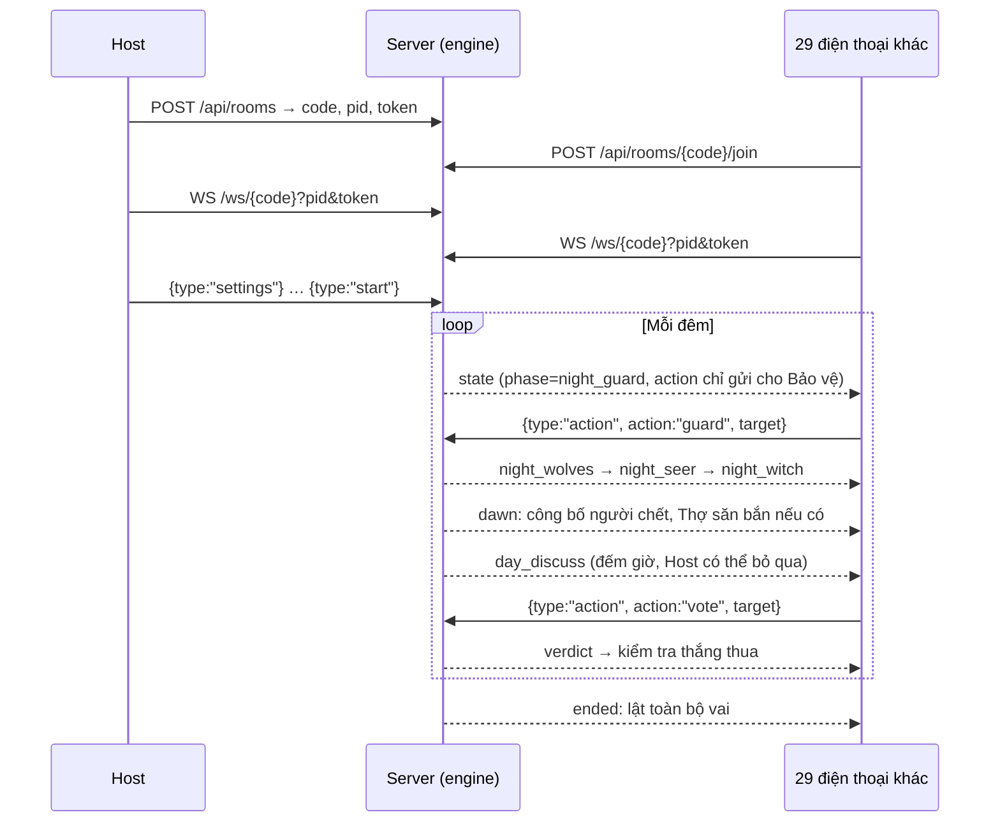

# Ma Sói – Quản trò tự động (10–30 người)

Ứng dụng web chạy trên trình duyệt điện thoại. Server đóng vai quản trò: chia vai, gọi từng vai thức dậy, đếm giờ, tính người chết, kiểm phiếu và xét thắng thua. Không ai cần cài app.

## Chạy máy chủ ngay trên điện thoại Android (Termux)

Một điện thoại Android vừa làm máy chủ vừa chơi được như mọi người. iPhone không chạy được máy chủ (iOS tắt app nền), nhưng vào chơi bằng cách quét QR thì bình thường.

1. Cài **Termux** từ F-Droid (bản trên Google Play đã cũ). Chép thư mục `masoi` vào máy, ví dụ vào `~/masoi`.
2. Cài một lần:
   ```bash
   pkg update && pkg install python rust binutils
   pip install fastapi uvicorn websockets qrcode
   ```
   FastAPI cần `pydantic-core` viết bằng Rust, Termux sẽ tự biên dịch nên lần đầu có thể mất 10–30 phút.
3. Mỗi lần chơi:
   ```bash
   termux-wake-lock          # không cho Android tắt máy chủ khi tắt màn hình
   cd ~/masoi && python main.py
   ```
   Terminal in ra địa chỉ LAN kèm mã QR. Trên chính điện thoại đó, mở Chrome vào `http://localhost:8000` rồi tạo phòng.
4. Phòng chờ hiện mã QR. Người khác quét bằng camera là vào thẳng phòng, chỉ cần nhập tên. Bấm *Phóng to* để QR chiếm cả màn hình nền sáng, dễ quét trong phòng tối. Ai đã vào phòng cũng thấy QR này, nên 30 người có thể quét từ nhiều máy cùng lúc.

**Mạng**: mọi người phải dùng chung mạng với máy chủ. Có hai cách:
- **Điểm phát sóng của máy chủ** (không cần internet). Lưu ý nhiều máy Android chỉ cho 8–10 thiết bị kết nối hotspot; xem mục "Số thiết bị tối đa" trong cài đặt điểm phát sóng. Nếu máy không cho đủ, dùng router Wi-Fi.
- **Chung một router Wi-Fi**. Wi-Fi quán cà phê, khách sạn thường chặn các máy nói chuyện với nhau (client isolation), khi đó QR sẽ không mở được.

Khi điện thoại báo "Wi-Fi không có internet", hãy chọn *Vẫn kết nối*, nếu không máy có thể tự chuyển sang 4G và không vào được phòng.

**Nếu QR không mở được**: bấm *Không vào được?* để đổi sang địa chỉ IP khác (máy có nhiều card mạng), hoặc tự ép địa chỉ: `MASOI_URL=http://192.168.43.1:8000 python main.py`. Đổi cổng bằng `MASOI_PORT`.

Mạng LAN chạy `http://` (không có HTTPS) nên trình duyệt tắt vài tính năng: giữ màn hình sáng và nút chia sẻ hệ thống. App tự bỏ qua các tính năng đó. Hãy chỉnh thời gian tắt màn hình lâu hơn trước khi chơi. Font chữ tải từ Google sẽ tự chuyển sang font hệ thống khi không có internet.

## Đưa lên mạng (Render) – dùng được cả khi máy chủ không phải Android

1. Tạo Web Service trên render.com, chọn repo GitHub này, môi trường Python.
2. Build command: `pip install -r requirements.txt`
3. Start command: `uvicorn main:app --host 0.0.0.0 --port $PORT`
4. Chỉ chạy 1 instance (trạng thái phòng nằm trong RAM).

Mã QR tự dùng địa chỉ https của Render, mọi người vào bằng 4G được.

## Hai chế độ chơi

- **🌐 Chơi online:** chỉ người thật, mọi người quét mã QR để vào phòng.
- **🤖 Chơi với máy:** người thật chơi cùng "máy chơi" do server điều khiển (chủ phòng thêm/bớt máy hoặc bấm *Lấp đủ 8/10/12… người*). Máy tự chọn mục tiêu ban đêm (sói máy đi theo lựa chọn của sói người), lên tiếng lúc thảo luận (Tiên Tri máy công khai kết quả soi, sói máy đổ tội người khác…) và bỏ phiếu. Nút *Vote ngay* chỉ tính phiếu của người thật. Khi không có máy quản trò riêng, bật *Máy tôi đọc lời quản trò* để điện thoại chủ phòng đọc lời dẫn.

Chuyển chế độ ngay ở phòng chờ trong mục *Chế độ chơi*.

## Máy quản trò (giọng đọc tiếng Việt)

Ở trang chủ chọn **🎙️ Tạo phòng – máy này làm quản trò**. Máy đó không nhận vai, đặt giữa bàn và đọc to toàn bộ lời dẫn bằng giọng tiếng Việt của điện thoại (Web Speech API), đồng thời hiện phụ đề và đồng hồ lớn. Người chơi quét QR vào phòng như bình thường; máy quản trò cũng là chủ phòng (chọn vai, chỉnh thời gian, bắt đầu ván).

Cần cài giọng tiếng Việt: iPhone vào Cài đặt → Trợ năng → Nội dung được đọc → Giọng nói → Tiếng Việt; Android cài Google Text-to-Speech và tải dữ liệu tiếng Việt. Bấm *Bật và nghe thử giọng* ở phòng chờ trước khi bắt đầu (trình duyệt cần một lần chạm mới cho phát tiếng).

Mỗi đêm quản trò đọc: "Màn đêm buông xuống, tất cả mọi người hãy nhắm mắt lại", rồi gọi lần lượt Kẻ Sáng Tạo (đêm 1, 30 giây), Kẻ Nhân Bản (đêm 1), Bảo Vệ, Ma Sói (20 giây), Phù Thủy, Tiên Tri, Nguyệt Nữ, Sói Băng, Kẻ Phù Phép (mặc định 5 giây mỗi vai, chỉnh được). Trước mỗi lượt có thêm 5 giây để đọc câu gọi. Vai nào có trong cấu hình cũng được gọi và chờ đủ giờ, kể cả khi người giữ vai đã chết hay lá đó là lá dư của Kẻ Sáng Tạo, nên không ai đoán được qua thời gian.

Trời sáng, quản trò đọc người chết (và vai nếu bật lật bài), người bị câm, lượt Thợ Săn, giờ thảo luận, giờ bỏ phiếu và người bị treo cổ cùng số phiếu. Hết ván, quản trò đọc lại toàn bộ diễn biến từng đêm, từng ngày; mọi điện thoại cũng hiện bản diễn biến này.

Sói Băng được gọi sau cùng nên lá phong ấn có hiệu lực cho đêm kế tiếp.

## Chạy trên máy tính

```bash
pip install -r requirements.txt
python main.py
```

Muốn thử một mình, mở 4 tab ẩn danh (`MIN_PLAYERS = 4` trong `game.py`; đổi thành 10 khi chơi thật). Kiểm tra engine bằng bot: `python simulate.py` (30 ván, một nửa bật đủ 16 vai).

```
masoi/
├── main.py          # FastAPI: REST tạo/vào phòng, WebSocket realtime, mã QR
├── game.py          # engine: vai, pha, luật, góc nhìn riêng từng người
├── index.html       # giao diện điện thoại, dark mode
├── requirements.txt
├── schema.sql       # PostgreSQL cho lịch sử & thống kê
└── simulate.py      # chạy thử 40 ván bằng bot
```

## 1. Tech stack và lý do chọn

**FastAPI + WebSocket gốc (không dùng Socket.io)** cho backend. Một tiến trình asyncio giữ được hàng trăm phòng 30 người; mọi thay đổi trạng thái chạy trên một event loop nên không cần lock. WebSocket gốc đủ dùng vì client tự nối lại khi mất mạng; Socket.io (`python-socketio`) chỉ đáng thêm khi bạn cần fallback long-polling cho mạng chặn WebSocket.

**Frontend**: bản mẫu là một file HTML thuần để chạy ngay. Khi làm sản phẩm thật, chuyển sang **React + Vite + Tailwind**, đóng gói PWA (thêm vào màn hình chính, chạy toàn màn hình). Logic hiển thị giữ nguyên vì client chỉ vẽ lại theo `state` server gửi.

**Không nên dùng Streamlit**: mỗi lần tương tác Streamlit chạy lại cả script và không có cơ chế đẩy sự kiện cho 30 người cùng lúc, nên không hợp với game realtime.

**Lưu trữ**: ván đang chơi nằm trong RAM (hoặc Redis khi mở rộng); PostgreSQL chỉ lưu lịch sử ván, nhật ký hành động và thống kê.

## 2. Dữ liệu và logic phân vai

Trạng thái lúc chơi (`game.py`): `Room` chứa `players`, `settings`, `phase`, `day_no`, `deadline`, các lựa chọn trong đêm (`guard_target`, `wolf_votes`, `seer_result`, `witch_heal`, `witch_poison`), số bình còn lại của Phù thủy, `last_guarded`, `day_votes` và `log` công khai. Mỗi `Player` có `role`, `alive`, `token` (để vào lại khi rớt mạng) và `private_log` (kết quả soi, bình đã dùng, đồng đội sói).

Lịch sử lâu dài (`schema.sql`): `rooms` → `games` → `game_players` (ghế, vai, đêm chết, nguyên nhân) và `game_actions` (mọi hành động theo thứ tự, đủ để phát lại cả ván).

**16 vai**, Host bật/tắt từng vai ở phòng chờ (Ma Sói chỉnh số lượng, Dân Làng tự lấp chỗ trống). Nút *Gợi ý theo số người* chia sẵn: Sói khoảng ¼ số người, càng đông càng thêm vai đặc biệt.

- Phe Dân Làng: Dân Làng, Bảo Vệ, Tiên Tri, Phù Thủy, Thợ Săn, Người Bệnh, Nguyệt Nữ, Kẻ Phù Phép.
- Phe Ma Sói: Ma Sói, Sói Biến Chủng, Sói Con, Sói Băng.
- Phe thứ ba & biến đổi: Kẻ Bị Nguyền, Kẻ Phản Bội, Kẻ Nhân Bản, Kẻ Sáng Tạo.

Thứ tự đêm: Kẻ Sáng Tạo (đêm 1) → Kẻ Nhân Bản (đêm 1) → Bảo Vệ → Ma Sói → Phù Thủy → Tiên Tri → Nguyệt Nữ → Sói Băng → Kẻ Phù Phép.

**Luật đã cài**:
- Bảo Vệ không che một người hai đêm liền. Nguyệt Nữ chọn soi đúng vai một người, hoặc che chắn một người khỏi bị cắn và bị phong ấn.
- Phù Thủy cứu trúng người đã được bảo vệ thì được hoàn bình cứu; đầu độc người đằng nào cũng chết vì sói thì được hoàn bình độc.
- Thợ Săn chỉ được bắn khi chết trong đêm.
- Người Bệnh bị cắn chết thì đêm sau bầy không cắn. Sói Con chết thì đêm sau bầy cắn 2 người.
- Sói Băng phong ấn một người cho đêm kế tiếp: Bảo Vệ, Tiên Tri, Phù Thủy, Nguyệt Nữ, Kẻ Phù Phép mất lượt; Thợ Săn không bắn được; Người Bệnh mất tác dụng.
- Sói Biến Chủng là Dân Làng trong đêm 1 (Tiên Tri soi ra Dân), từ đêm 2 vào bầy.
- Kẻ Bị Nguyền bị cắn thì hoá sói. Kẻ Phản Bội soi ra Dân; khi sói chết hết thì hoá Ma Sói cuối cùng.
- Kẻ Nhân Bản nhận vai và phe khi mục tiêu chết. Có Kẻ Sáng Tạo thì cần thêm 2 lá: 2 lá dư được Kẻ Sáng Tạo xem và chọn 1.
- Treo cổ cần đa số tương đối; hoà hoặc phiếu trắng nhiều bằng/hơn thì không ai chết. Người bị phù phép vẫn được bỏ phiếu.
- Dân thắng khi hết sói (và không còn Sói Biến Chủng hay Kẻ Phản Bội chờ hoá sói). Sói thắng khi số sói bằng hoặc nhiều hơn số người còn lại.

**Chống lộ thông tin**: vai đã chết vẫn có lượt "thức dậy" giả 3–6 giây; người chết trong đêm được xáo thứ tự nên không biết ai chết vì sói, ai vì độc; mỗi điện thoại nhận một gói `state` riêng qua `view_for(pid)`.

## 3. Luồng thời gian thực



Nguyên tắc: **server là nguồn sự thật duy nhất**. Client chỉ gửi ý định (`action`), server kiểm tra đúng pha, đúng vai, mục tiêu còn sống, rồi gửi lại `state` đầy đủ cho từng người. Mỗi bước có `deadline` (giờ server) và client tính độ lệch đồng hồ từ `server_now`, nên 30 máy đếm ngược khớp nhau. Bước kết thúc sớm khi mọi người cần hành động đã xong. Rớt mạng thì client tự nối lại với `pid + token` lưu trong `localStorage` và nhận ngay trạng thái hiện tại.

Tin nhắn client → server: `settings`, `start`, `restart`, `kick` (chỉ Host), `action` (`guard`, `wolf_vote`, `seer_check`, `seer_ack`, `witch_heal`, `witch_poison`, `witch_done`, `vote`, `hunter_shoot`, `hunter_skip`, `skip_discussion`), `leave`, `ping`.

## 4. Giao diện và luồng trải nghiệm

Bầu trời là chỉ báo pha: đêm có nền chàm sâu, ngày chuyển sang nâu than hồng, nên nhìn lướt cũng biết đang ở pha nào. Chữ màu ngà thay vì trắng tinh để không chói trong phòng tối; màu hổ phách cho hành động chính, đỏ máu cho hành động không hoàn tác (cắn, đầu độc, bắn). Nút tối thiểu 52px, tiêu đề dùng Lora, nội dung dùng Be Vietnam Pro (đều hỗ trợ dấu tiếng Việt).

**Host**: Trang chủ → nhập tên → *Tạo phòng mới* → phòng chờ hiện mã 4 chữ và nút *Gửi lời mời* (chia sẻ link `?room=ABCD`). Host chỉnh số lượng từng vai bằng nút −/+, chọn thời gian mỗi lượt đêm, thảo luận, bỏ phiếu, bật/tắt lật vai người chết. Dòng trạng thái báo ngay nếu vai chưa khớp số người; nút *Bắt đầu ván* chỉ sáng khi hợp lệ. Trong ngày, Host có thêm nút bỏ qua thảo luận. Hết ván có *Chơi ván mới* giữ nguyên phòng.

**Người chơi**: nhập mã → phòng chờ thấy danh sách người và cấu hình (chỉ xem). Khi vào ván, vai được giấu sau nút *Giữ để xem vai của bạn*: nhấn giữ thì hiện vai, phe, mô tả và ghi chú bí mật; thả tay là che lại ngay. Ban đêm mọi máy hiện cùng một màn hình "Hãy nhắm mắt"; chỉ máy có lượt mới rung và hiện lưới người chơi. Chọn mục tiêu theo hai bước: chạm vào người, rồi bấm nút xác nhận ở đáy màn hình để tránh bấm nhầm. Ban ngày có lưới cả làng (người chết bị gạch tên), màn bỏ phiếu hiện số phiếu trực tiếp và cho đổi phiếu trước khi hết giờ. Người chết chuyển sang chế độ theo dõi. Màn hình được giữ sáng (Wake Lock) suốt ván.

## 5. Mở rộng khi lên production

- Nhiều worker/máy chủ: lưu `Room` vào Redis, dùng Redis pub/sub để phát `state`, bật sticky session ở load balancer, và chạy vòng lặp ván ở một worker giữ khoá phòng.
- Ghi `game_actions` vào PostgreSQL theo lô sau mỗi pha để làm thống kê, phát lại ván.
- Thêm âm thanh lời dẫn (Web Speech API) phát trên máy Host, chat riêng cho bầy sói, thêm vai bằng cách thêm bước vào `_night()`.
- Bảo mật: HTTPS/WSS, giới hạn tốc độ tạo phòng, rút ngắn `ROOM_TTL`.
